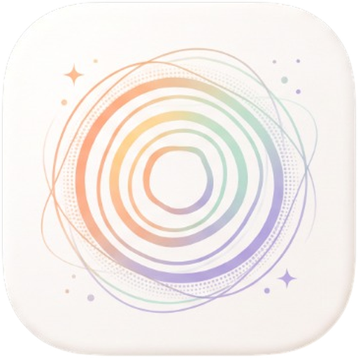

<p align="center">
  
</p>

# ToLivePhoto

Windows 原生桌面工具，将任意视频一键转换为 **iPhone 原生可识别、U盘直导合成** 的 **Live Photo（实况照片）**。

## 核心特性

- **真·iPhone Live Photo 配对规范**
  - 生成配对的 `HEIC + MOV`（或 `JPG + MOV`），内嵌大端序 `Apple iOS` `MakerNote (0x0011 ContentIdentifier)` 与 QuickTime `com.apple.quicktime.content.identifier`、`still-image-time` 元数据轨。
  - `ftyp -> moov -> mdat` 优化封装；支持导出到 **普通文件夹**（可选打包 `.livp`）或 **U 盘相机 (`DCIM/100APPLE`)**，U 盘插入 iPhone 后通过系统「照片」App 右下角「导入」即可直接合成实况照片。
- **双模式工作流与统一 `_2live` 命名**
  - **简易模式**：一键配置静音、帧率（原帧率 / 原始帧重排 30 帧 / 极速光流补帧）、iPhone 实况参考码率与导出目录，默认使用 `源文件名_2live` 命名。
  - **高级模式**：普通文件夹与 U 盘 DCIM 共用统一命名规则（`源名+后缀` `_2live` / `原文件名` / `前缀+序号` / `自定义` + `防重名自动编号`），告别繁琐的旧式相机编号。
- **全分辨率瓷白画布、比例裁切与拍立得套框**
  - 瓷白画布 (`#FEFDF9`) + 全分辨率 FFmpeg 硬件解码预览，支持滚轮缩放、左键拖拽平移、双击 100%/200% 切换、按住对比原片；裁切模式下点击画面外空白处自动隐藏裁切框并直接拖动画布。
  - **比例裁切 + 7 向快速对齐**：支持 `自由 / 原比例 / 1:1 / 2:3 / 3:4 / 9:16`、免冒号手动输入比例、横竖屏切换、内裁填满 / 外扩留边 / +10% 留边，以及 `全居中 / 左右居中 / 上下居中 / 靠上 / 靠下 / 靠左 / 靠右` 快速对齐。
  - **可组合拍立得相纸**：预设显示各自画幅比（`Mini · 3:4`、`Square · 1:1`、`Wide · 16:10`、`600 · 1:1`），并支持 **「保持裁切比例套框」**——先在比例裁切中裁好构图，再直接套入拍立得相纸边框；外扩背景支持高斯模糊、纯白（画布自动切换柔雾对比底色不融边）、纯黑与自定义取色。
- **帧率重排与 AI 光流补帧（GPU Vulkan 加速）**
  - 默认保持原帧率；支持不丢帧原始帧重排，以及基于 `rife-ncnn-vulkan`（类 DLSS / 小黄鸭原理）的 GPU AI 光流补帧（默认 30 帧，支持 `24 / 25 / 30 / 60` 及 `2x / 3x / 4x` 倍率）。
  - 全程采用 **`X秒Y帧`** 直观显示；超过 3 秒可一键点击 **`✂ 控时3秒`** 在主图附近自动裁切 3 秒片段，不改动目标帧率。
- **自定义主图、多视频队列与同目录 EXIF 自动匹配**
  - 支持多视频同时导入、缩略图队列切换、一键同步参数与批量导出。
  - 打开视频时自动读取同目录同名照片/RAW 的 EXIF 参数（支持 `.CR3 / .CR2 / .NEF / .ARW / .DNG / .RAF / .JPG / .HEIC`），也支持手动选择文件夹匹配或自定义编辑。

## 运行与安装

```bash
pip install -r requirements.txt
python -m tolivephoto.app
```

Windows 可直接双击 `启动_ToLivePhoto.bat` 无终端窗口启动。

可选下载 RIFE Vulkan 补帧引擎（约 22 MB，含 `rife-v4.25` 与 `rife-v4.6` 模型）：

```bash
python scripts/setup_rife.py
```

## 测试

```bash
pytest -v
```
